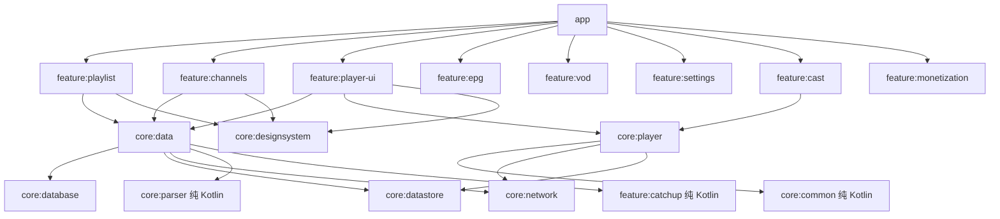

# StreamDeck Player

纯 IPTV 播放器（**不提供任何内容**，用户自行添加播放列表）。当前进度：**P0–P8（全部阶段代码已完成，未经编译验证）**。

> ⚠️ 本仓库代码由 AI 生成，**尚未在真实 Android SDK 上编译验证**。首次打开请先执行 `./gradlew ktlintFormat`，再按编译报错逐项修复。

## 构建
1. Android Studio Ladybug (2024.2) 或更新，JDK 17。
2. 打开项目根目录；若无 wrapper：`gradle wrapper --gradle-version 8.11.1`。
3. 运行 `app` 到手机 / 平板 / Android TV 模拟器。
4. 单元测试：`./gradlew test testDebugUnitTest`；静态检查：`./gradlew ktlintCheck detekt`。
5. Release：见 `docs/RELEASE.md`（P8 起提供）。

## 模块

| 模块 | 内容 |
|---|---|
| core:common | 纯 Kotlin：ReconnectPolicy（指数退避+抖动+上限）、URL 脱敏 |
| core:parser | 纯 Kotlin：流式 M3U 解析、频道唯一键 |
| core:database | Room + FTS4 |
| core:datastore | DataStore 设置、Keystore 凭据加密、语言 |
| core:network | OkHttp、明文 HTTP 拦截、脱敏日志、Xtream API（Retrofit） |
| core:data | 仓库：播放列表导入、频道、流地址解析 |
| core:designsystem | 主题 token、FocusSurface、按钮/输入框/卡片、ActionPanel、对话框、统一的空/加载/错误/进度状态 |
| core:player | 单例 PlayerController、PlaybackService（MediaSession）、轨道、睡眠定时、网络监听 |
| feature:playlist | 首启引导、添加播放列表、播放列表管理与编辑器 |
| feature:channels | 分组 / 频道列表 / 搜索 |
| feature:epg | 网格 EPG、频道节目列表、节目详情、提醒、手动匹配 |
| feature:catchup | 纯 Kotlin：回看 / 时移 URL 生成器 |
| feature:vod | Xtream 电影 / 剧集浏览、详情、续播、已看 |
| feature:settings | 设置、家长控制（PIN 门控）、备份恢复、播放列表更新策略 |
| feature:cast | Chromecast 投屏按钮、遥控、能否投屏的判断 |
| feature:monetization | 广告 / 内购接口与空实现（默认关闭） |
| feature:player-ui | 播放界面、手势、遥控器、覆盖层、轨道/比例/字幕/定时面板 |

## 测试
| 模块 | 测试 | 数量 |
|---|---|---|
| core:parser | M3uParserTest + M3uParserEdgeCaseTest | 36 |
| core:parser | XmltvParserTest / XmltvTimeTest / EpgMatcherTest | 6 / 8 / 8 |
| feature:catchup | CatchupUrlBuilderTest（含时区、夏令时、负偏移） | 30 个测试，共 39 个用例 |
| core:common | ReconnectPolicyTest / RedactTest / PinTest | 9 / 4 / 7 |
| core:network | XtreamParsersTest | 10 |
| core:data | FtsQueryTest / VodKeyTest | 3 / 3 |
| feature:playlist | HeaderLinesTest（自定义请求头文本 ↔ JSON） | 6 |
| core:player | BufferProfileTest | 2 |
| feature:cast | CastRulesTest | 3 |
| core:database（仪器测试） | ImportAndOverridesTest | 2 |
| core:designsystem（Compose UI 测试） | StatesTest | 2 |

运行：`./gradlew test testDebugUnitTest`；仪器测试：`./gradlew connectedDebugAndroidTest`。

## 文档
`ARCHITECTURE.md` · `docs/P2_REPORT.md` … `docs/P8_REPORT.md` · `docs/RELEASE.md` · `docs/PRIVACY_POLICY.md` · `docs/STORE_LISTING.md` · `docs/signing.properties.template`

各阶段说明见 `docs/P*_REPORT.md`，设计决策见 `ARCHITECTURE.md`。

## UI（v0.10）
手机与 TV 两套界面在运行时按 UI 模式选择，支持浅色 / 深色 / 跟随系统 / AMOLED。
- v0.9：直播首页、播放页、我的、TV 首页 / 网格 EPG / 播放覆盖层按 6 张设计图重做。
- v0.10：点播（首页 + 详情）、添加播放列表（含导入进度页）、播放列表管理与编辑器、首启引导、单频道节目表也按同一设计语言重做，并统一了空 / 加载 / 错误 / 进度状态组件、操作面板（手机底部弹层 / TV 侧边面板）和对话框。

详见 [docs/UI_REFACTOR_REPORT.md](docs/UI_REFACTOR_REPORT.md)（第 9 节起为 v0.10 内容）。
